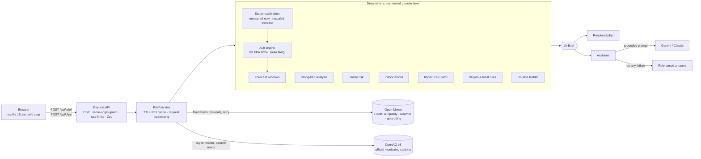

# AirWise · Urban Air Quality Assistant

> A GenAI-powered assistant that helps **families and communities get through severe winter smog**. It turns
> **measured air from the nearest official monitoring stations** and live air-quality and weather forecasts into a
> **low-emission daily routine**, **indoor air-quality hacks** and
> **sustainable alternatives** tailored to each household's location and lifestyle, and shows **the direct impact of
> every choice in numbers** (µg of PM2.5 you breathe, indoor PM2.5 before → after, kg CO₂ and g PM2.5 avoided per year,
> multiplied across your whole residents' association).

**Chosen vertical:** Challenge 6, _Urban Air Quality Assistant_.

**Live app:** https://airwise-urban-air-assistant.vercel.app (Vercel, Mumbai region)

**Demo video (2:40):** https://youtu.be/1Vuj0Vgyci4 (live testing on the deployed app, Gemini in English and Hindi,
and how the GenAI is grounded in measured data)

---

## Contents

1. [The problem and how AirWise answers it](#1-the-problem-and-how-airwise-answers-it)
2. [What a family sees](#2-what-a-family-sees)
3. [How it works (architecture)](#3-how-it-works-architecture)
4. [Approach and decision logic](#4-approach-and-decision-logic)
5. [GenAI design: grounded, safe, always available](#5-genai-design-grounded-safe-always-available)
6. [Assumptions](#6-assumptions)
7. [Quality: security, efficiency, testing, accessibility](#7-quality-security-efficiency-testing-accessibility)
8. [Run it locally](#8-run-it-locally)
9. [Deploy (Vercel)](#9-deploy-vercel)
10. [Project structure](#10-project-structure)
11. [Data sources and references](#11-data-sources-and-references)
12. [Limitations and next steps](#12-limitations-and-next-steps)

Design decisions and the red-team log behind them: [`docs/DECISIONS.md`](docs/DECISIONS.md).

---

## 1. The problem and how AirWise answers it

Every winter, cities across North India sit under a smog lid: calm, cold nights collapse the atmosphere's mixing layer
to a few tens of metres and trap traffic exhaust, cooking and heating smoke, and crop-residue smoke over the city.
Families face daily decisions with real health consequences: _can the kids play outside, when should I open the
windows, is my purifier enough, should I take the metro?_ They also want to know what _they_ can do about it.

| Problem-statement requirement         | How AirWise delivers it                                                                                                                                                                                                                                                                                                                                                                                                                                                                                                                           | Code                                                                          |
| ------------------------------------- | ------------------------------------------------------------------------------------------------------------------------------------------------------------------------------------------------------------------------------------------------------------------------------------------------------------------------------------------------------------------------------------------------------------------------------------------------------------------------------------------------------------------------------------------------- | ----------------------------------------------------------------------------- |
| **GenAI-powered assistant**           | Chat assistant on Google **Gemini** (default) or **Claude**, grounded in a per-household "air brief" computed by deterministic engines; falls back to a rule-based assistant so it always answers                                                                                                                                                                                                                                                                                                                                                 | `src/services/assistant/`                                                     |
| **Families and communities**          | Household profile (adults, children, older adults, health conditions); family risk follows the most vulnerable member; per-member advice; "households acting together" multiplies every action and adds a **community headline** ("70.2 t CO₂ and 103.9 kg PM2.5 avoided a year across 50 households", overlapping transport options counted once); one-tap sharing of the plan                                                                                                                                                                   | `src/domain/risk.ts`, `src/domain/impact/actions.ts`, `public/js/app.js`      |
| **Severe winter smog**                | Smog-trap analysis from mixing height × wind (_ventilation coefficient_), fog detection, worst-period warning, India's CPCB National AQI chosen automatically in India, and **Delhi-NCR GRAP stage** detection with what each stage means for this family (school notices, restricted cars, work-from-home orders)                                                                                                                                                                                                                                | `src/domain/smog.ts`, `src/domain/policy.ts`, `src/domain/aqi/`               |
| **Low-emission daily routines**       | A time-stamped routine built from the hourly forecast: cleanest hour to exercise, when to air the home, children's play slot, commute choice, cooking, close-up before the peak, bedtime filtration                                                                                                                                                                                                                                                                                                                                               | `src/domain/routine.ts`                                                       |
| **Indoor air-quality hacks**          | Purifier and DIY fan-filter sizing with a mass-balance model, smart ventilation timing, gap sealing, clean cooking and heating, mosquito-coil and houseplant myth-busters, each with its quantified effect                                                                                                                                                                                                                                                                                                                                        | `src/domain/indoor.ts`                                                        |
| **Sustainable alternatives**          | Commute comparison (metro, bus, carpool, EV, cycling, walking), home-working days, no-idling, composting instead of burning, clean cooking fuel, electric heating, saving electricity                                                                                                                                                                                                                                                                                                                                                             | `src/domain/impact/`                                                          |
| **Tailored to location**              | **Measured air from the nearest official monitoring stations** (OpenAQ; in Delhi these are CPCB/DPCC monitors) with the CAMS forecast calibrated to them, plus weather forecasts, for any searched city or the browser's location; the source is named on screen; local AQI standard; local-time windows; **country grid carbon intensity** prices EV, metro, heating and electricity impacts (Delhi 0.72 vs London 0.21 kg CO₂/kWh); local emergency number; Indian schemes (Ujjwala, Sameer app, "Red Light On, Gaadi Off") only shown in India | `src/services/openaq.ts`, `src/domain/calibration.ts`, `src/domain/region.ts` |
| **Tailored to lifestyle**             | Commute mode and distance, home-working, cooking fuel, winter heating, outdoor exercise, room size, purifier CADR, health conditions                                                                                                                                                                                                                                                                                                                                                                                                              | `src/domain/household.ts`                                                     |
| **Clearly explain the direct impact** | Every recommendation carries an "Impact:" line with numbers from transparent, cited factors: inhaled µg of PM2.5, indoor PM2.5 before → after, kg CO₂, g PM2.5 and NOx per year, tree-equivalents, community totals                                                                                                                                                                                                                                                                                                                               | `src/domain/impact/`, `src/domain/indoor.ts`                                  |

## 2. What a family sees

**A landing page, then an app.** The hero ("Breathe easier this winter.") has a big search bar, **one-tap popular
cities** (Delhi, Mumbai, Kolkata, Lucknow, Patna, Bengaluru) and _Use my location_ (if the device cannot locate
itself, AirWise falls back to the approximate city from your network and says so; a blocked permission is respected). Once a city is chosen, the page
becomes a **tabbed app**:

- A **location bar** with the place, a live AQI pill in the category colour, a **"● Live station data"** or **"Model
  estimate"** badge, and _Change city_.
- **Seven tabs**: Today · Forecast · My day · Home air · Impact · Family · Ask AI. Each tab has its own URL
  (`#/impact`), so links and the back button work. Tabs follow the WAI-ARIA keyboard pattern and become a bottom
  navigation bar on phones.
- The whole page **re-tints with the air**: green on clean days, then amber, rust, purple or maroon as the AQI worsens.

| Tab          | What the family sees                                                                                                                                                                                                                                                                                                                                                                                                                                                                                                                                                                                                                                                                                                                                   |
| ------------ | ------------------------------------------------------------------------------------------------------------------------------------------------------------------------------------------------------------------------------------------------------------------------------------------------------------------------------------------------------------------------------------------------------------------------------------------------------------------------------------------------------------------------------------------------------------------------------------------------------------------------------------------------------------------------------------------------------------------------------------------------------ |
| **Today**    | **Air right now:** an animated, colour-banded **AQI dial** with the category on the local scale, and the air in relatable terms (**"≈ 1.5 cigarettes a day"**, the Berkeley Earth equivalence, and **"2.3× the WHO daily limit"**). **Where the numbers come from:** station names, distances and measurement time, or a clear warning that the value is a model estimate. **Today at a glance:** five decision tiles (mask, windows, exercise, kids outside, commute), colour-coded _and_ labelled. **What it means for your family:** a verdict for the most vulnerable member, _Why this advice?_, advice per member and, in Delhi-NCR, the **GRAP stage** in force. Quick actions: _Share today's plan_ (WhatsApp-ready) and _Read summary aloud_. |
| **Forecast** | An SVG 24-hour chart with the **cleanest and worst windows highlighted**, a "Now" marker, and a plain-language smog-trap (winter inversion) explanation.                                                                                                                                                                                                                                                                                                                                                                                                                                                                                                                                                                                               |
| **My day**   | A timeline routine, for example _"16:00–17:00 · Exercise outdoors in the cleanest hour"_ or _"Before 07:00 tomorrow · Close up the house"_. Every step has an **Impact:** line.                                                                                                                                                                                                                                                                                                                                                                                                                                                                                                                                                                        |
| **Home air** | A **before/after bar visual** (outdoors → indoors → with a DIY fan filter → with a purifier sized for the room) and prioritised hacks with their quantified effect.                                                                                                                                                                                                                                                                                                                                                                                                                                                                                                                                                                                    |
| **Impact**   | Headline tiles (CO₂ and PM2.5 avoided a year, tree-equivalents), a **live "households acting together" slider** that updates every figure instantly, a commute comparison and **pledge buttons** with a running yearly total.                                                                                                                                                                                                                                                                                                                                                                                                                                                                                                                          |
| **Family**   | A visual editor: − / + steppers, condition chips and icon tiles for commute, cooking fuel and heating. Saved in the browser; every recommendation uses it.                                                                                                                                                                                                                                                                                                                                                                                                                                                                                                                                                                                             |
| **Ask AI**   | A chat with suggested questions and a **voice button** (English or Hindi). Answers come from Gemini, grounded in the same numbers, in the language you used, with the engine named under each answer.                                                                                                                                                                                                                                                                                                                                                                                                                                                                                                                                                  |

## 3. How it works (architecture)



**Request flow for one family:**

1. The browser sends `POST /api/brief` with `{ location, standard, household }`. Health details travel in the body,
   never in the URL.
2. Zod validates the request strictly (unknown keys rejected, every number bounded).
3. The brief service loads, **in parallel**, the air-quality forecast, the weather and the nearest stations' latest
   measurements for the rounded coordinates (cache hit, a shared in-flight request, or upstream with a timeout).
   Failures degrade gracefully: without weather only the smog outlook is skipped, and without stations "right now"
   becomes a clearly labelled model estimate.
4. Pure functions compute the `AirBrief`. First, **calibration** replaces the model's "now" with the measured values
   and rescales the forecast to match. Then come AQI, hourly index, windows, smog trap, family risk, indoor plan,
   commute comparison, actions, routine, data-source label and summary.
5. `POST /api/chat` reuses the same brief and adds the question and a trimmed history; the assistant asks the LLM to
   answer **only from the brief**, or answers with rules.

The domain layer has **no I/O**. It is the reason every recommendation is explainable and unit-testable.

## 4. Approach and decision logic

### 4.1 Real measurements first (`src/services/openaq.ts`, `src/domain/calibration.ts`)

Global air-quality models such as Copernicus CAMS capture the daily rhythm of pollution but can badly under-read winter
smog in South Asian cities. While testing on a late-November afternoon (24 Nov 2026), the model alone rated Delhi
**NAQI 90, "Satisfactory"**. So AirWise treats official monitoring stations as the truth for "right now" and uses the
model only for what stations cannot do: forecast.

1. **Find stations.** OpenAQ v3 `/locations` within 25 km, reference monitors only (`monitor=true`, and `isMonitor`
   re-checked), with a PM2.5 or PM10 sensor and a reading in the last 6 hours (CPCB data reaches OpenAQ about 3–4 hours
   after measurement). The nearest 3 by great-circle distance
   are used.
2. **Read them in parallel.** `/locations/{id}/latest` for each; readings are joined to their sensor by `sensorsId`.
   One failing station is skipped; if all fail, the error is logged and the app falls back (step 5).
3. **Normalise.** Units are converted to µg/m³ (ppb and ppm via molecular weight at 25 °C, mg/m³ × 1000). Null,
   negative and stale values are dropped (stations also list old, retired sensors), and each pollutant is averaged
   across the stations.
   - **A unit bug in the source data, found and corrected:** OpenAQ labels India's CPCB gas sensors "ppb", but the
     values are CPCB's native units (µg/m³; mg/m³ for CO). Live Delhi data proves it: NOx (ppb) equals NO + NO₂ only
     when NO and NO₂ are read as µg/m³ (all 10 stations checked agree within 0.3 ppb), and "0.87 ppb" of CO is
     physically impossible outdoors. Trusting the labels would overstate NO₂ and SO₂ about 1.9–2.6× and understate
     CO about 1,000×.
4. **Calibrate.** "Right now" uses **only measured values**. For each measured pollutant, factor = measured ÷ modelled
   **at the hour the stations measured** (official data is published hours late; clamped to 0.2–8×), and every forecast hour is multiplied by it. Pollutants the stations do not
   measure are left out of the forecast instead of mixing calibrated and uncalibrated values.
5. **Say where it came from.** The brief carries a `dataSource` label shown on the Today tab, as a badge in the
   location bar, and in the assistant's answers, for example _"Measured 13:30–16:00 by 3 monitoring stations via OpenAQ:
   Chandni Chowk, Delhi - IITM (0.7 km), New Delhi (1.9 km), ITO, New Delhi - CPCB (2.8 km)"_ (live, 24 Nov 2026,
   NAQI 239 "Poor", where the model alone said 90 "Satisfactory"). Without a key, or when no station has reported recently, the label warns that the value is a model
   estimate that can under-read winter smog.

### 4.2 AQI engine: two standards, one algorithm (`src/domain/aqi/`)

- Breakpoint tables are **data**: US EPA (2024 revision with new PM2.5 breakpoints) and India's CPCB National AQI.
- Sub-index = piecewise-linear interpolation `I = (Ihi − Ilo)/(Chi − Clo) × (C − Clo) + Ilo`, after converting µg/m³
  to the table's unit (ppb/ppm at 25 °C via molecular weight, or mg/m³) and **truncating** (EPA rule).
- Overall AQI = the maximum sub-index; that pollutant is _dominant_ (ties resolve to PM2.5).
- **Standard choice is context-aware:** `auto` picks NAQI when the place is in India (country code or `Asia/Kolkata`
  timezone), otherwise US AQI. Users can override.
- Each category maps to a common **severity level 0–5**, so the rest of the logic is standard-agnostic.

### 4.3 Smog-trap analysis (`src/domain/smog.ts`)

- **Ventilation coefficient** VC = mixing height (m) × wind (m/s). Below 2,000 m²/s means poor dispersion;
  6,000 m²/s and above means good.
- The share of stagnant hours in the next 24 sets the trap risk: ≥ 75 % severe, ≥ 50 % high, ≥ 25 % moderate.
  Without mixing-height data it falls back to calm wind (< 5 km/h).
- It finds the best 3-hour dispersion window and flags fog (relative humidity ≥ 90 % and ≤ 15 °C), which turns smoke
  into dense smog.

### 4.4 Forecast windows (`src/domain/forecast.ts`)

- Hourly index from hourly concentrations, the exposure people actually experience at that hour.
- A sliding-window search (n ≤ 24) finds the **cleanest hour 06–21** (exercise), the **cleanest 2 h 08–19** (airing
  the home), the **cleanest hour 14–19** (children's play) and the **worst 3 h** (close-up time). Ties go to the
  earlier slot.
- The trend compares now with the next 6 h (a change of ±10 % or less counts as stable).

### 4.5 Family risk (`src/domain/risk.ts`)

```
personal level = air severity (0–5)
               + 1 if anyone at home is sensitive (children, older adults, asthma, COPD,
                   heart disease, diabetes, pregnancy) and the air is not "Good"
verdict: 0–1 normal · 2 take care · 3 limit outdoor · 4–5 stay indoors
```

The headline names who it is for. If the level was raised only because of a sensitive member, healthy adults get a
milder message. Condition-specific advice (inhaler, cardiac warning signs, pregnancy and so on) is added whenever the
air is above "Good".

### 4.6 Indoor model (`src/domain/indoor.ts`)

A single-zone steady-state mass balance (US EPA _Guide to Air Cleaners in the Home_; Riley et al. 2002):

```
C_in = P · λ · C_out / (λ + k + CADR / V)
P = 0.8 penetration · λ = 1.0 /h infiltration (windows shut) · k = 0.2 /h deposition · V = area × 2.7 m
```

- The recommended purifier CADR targets 5 clean-air changes per hour.
- A DIY fan filter is assumed conservatively at 150 m³/h.
- Gap sealing halves λ.
- Every hack states its effect, for example _"Indoor PM2.5 ≈ 38 → 8 µg/m³ (−79 %)"_.

### 4.7 Impact calculator (`src/domain/impact/`)

For each commute mode: CO₂, NOx and PM2.5 per passenger-km, an in-vehicle exposure ratio, a breathing rate and an
average speed.

```
inhaled PM2.5 per day (µg) = ambient PM2.5 × exposure ratio × inhalation rate (m³/h) × hours in transit
CO₂ per km                 = fuel CO₂ per km + electricity per km × local grid carbon intensity
yearly CO₂ saved           = (current − alternative) kg/week × 48 working weeks
```

The **community headline** sums one household's plan (only the single largest transport saving, because switching to
the metro and not idling your car are alternatives, not additions) and multiplies it by the households acting together.

**Health-first ranking.** On polluted days (severity ≥ 2), an alternative that raises your inhaled dose by more than
25 % is marked _"better on cleaner days"_ and is never the top recommendation, even if it saves the most CO₂. Zero
emissions does not make cycling through smog a good choice.

Household actions are home-working days, no-idling, composting instead of burning, clean cooking fuel, electric
heating instead of an angithi, and saving 1 kWh a day. Each is quantified per household and **× the number of
households acting together**. Every factor and its source is in the code comments and in [§ 11](#11-data-sources-and-references).

### 4.8 Routine builder (`src/domain/routine.ts`)

It combines windows, risk, smog, commute and indoor plan into time-ordered steps. Each step has **when**, **what**,
**how**, an **Impact:** line, and tags (_less exposure_, _fewer emissions_, _cleaner indoors_). Examples of its
decisions:

- Exercise outdoors only if the cleanest hour is at most moderate (stricter for sensitive households).
- Home-working on severe days when possible.
- Close the house before the forecast peak.

Every time label carries day context ("Before 07:00 **tomorrow**"), so evening users are never misled.

### 4.9 Location context and local rules (`src/domain/region.ts`, `src/domain/policy.ts`)

- `resolveRegion` derives the country (from the geocoder or the timezone), whether the place is in **Delhi-NCR**, the
  **grid carbon intensity** (Ember/IEA 2023, India from CEA) and the **emergency number** (112/108, 911, 999…).
- **GRAP** (Delhi-NCR's Graded Response Action Plan, run by CAQM) escalates measures by India NAQI: Stage I 201–300,
  II 301–400, III 401–450, IV above 450. AirWise always uses the NAQI for this (even when the user views the US scale),
  lists the cumulative measures, and translates them for the household. For example, a diesel-car family with
  children at Stage III hears about BS-IV diesel restrictions and school hybrid-mode notices. It always points to the
  official CAQM order.

## 5. GenAI design: grounded, safe, always available

| Design choice                                       | Why                                                                                                                                                                                                                                                                                                                                                                                                                    |
| --------------------------------------------------- | ---------------------------------------------------------------------------------------------------------------------------------------------------------------------------------------------------------------------------------------------------------------------------------------------------------------------------------------------------------------------------------------------------------------------- |
| **Deterministic engines compute, the LLM explains** | Numbers never come from the model. The prompt contains a compact JSON brief with **unit-explicit strings** ("52 kg PM2.5 per year"): live testing showed raw fields like `pm25GPerYear: 52000` made the model report kg instead of g, so quantities are pre-formatted. Rule 1 forbids inventing figures.                                                                                                               |
| **Provider-neutral interface** (`LlmProvider`)      | Gemini (an ordered model chain, default `gemini-3.5-flash-lite` → `gemini-3.8-flash`, free tier in Google AI Studio; retired, overloaded or slow models fall through automatically) or Claude (`claude-opus-5-5`, low effort, server-side refusal fallbacks) behind one interface; swapped by environment variable; fakes in tests. Verified against the live Gemini API: grounded English and Hindi answers in 1–5 s. |
| **Always answers**                                  | No key, a timeout, quota exhaustion, a refusal or empty output all fall back to the rule-based assistant built on the same brief. The response says which engine answered.                                                                                                                                                                                                                                             |
| **Prompt-injection boundary**                       | A static system prompt; user text stripped of `<` `>` and control characters and wrapped in `<question>`; history trimmed to 6 turns; place names limited to place-name characters; rule 8 declares user text to be data; replies capped at 3,000 characters and rendered as text only.                                                                                                                                |
| **Safety**                                          | "Not a doctor" rule; emergency guidance only on health questions, with the **local** emergency number from the brief; condition-aware advice.                                                                                                                                                                                                                                                                          |
| **Multilingual**                                    | The model replies in the user's language (English, Hindi, Hinglish). The rule engine recognises common Hinglish words.                                                                                                                                                                                                                                                                                                 |
| **Privacy**                                         | Only the household profile (no names, accounts or identifiers) and the rounded location are sent to the provider. The UI says so. Logs never contain messages or profiles.                                                                                                                                                                                                                                             |

## 6. Assumptions

- **Measured data:** "right now" is the average of up to 3 reference monitors within 25 km that reported in the last
  6 hours. Official data is published hours late, so the UI shows the measurement time (or range), and anything
  older than 6 hours is ignored.
- **Forecast calibration:** the model's hour-to-hour shape is kept, and its error at the measurement hour is assumed to
  hold for the next 24 hours (one factor per pollutant, clamped to 0.2–8×).
- **Fallback data:** without station data, Open-Meteo's CAMS model gives concentrations on a ~10–45 km grid. These
  are modelled values, and the UI and assistant say so.
- **Hourly index:** the hourly index applies the standard's breakpoints to hourly concentrations (as consumer apps do)
  instead of the regulatory 24-h or 8-h averages. This is more responsive, and more conservative for ozone.
- **CPCB Severe band:** the band is open-ended. Its upper bound is closed with the previous band's width so the index
  saturates at 500.
- **US ozone above 200 ppb:** the 301–500 range uses an approximation (practically never reached in cities).
- **Impact factors** are typical urban values: solo occupancy for cars, 5 commute days a week, 48 working weeks a
  year, the country's grid carbon intensity (world average 0.48 kg CO₂/kWh when unknown), 2 kg a week of waste that
  would otherwise be burned, and 21 kg CO₂ a year per tree. They are **estimates for comparing choices**, and the UI
  labels them as such.
- **Delhi-NCR** is approximated by a bounding box (27.85–29.45 °N, 76.2–78.1 °E). GRAP stages are shown from the current
  reading; the official stage is set by CAQM orders based on daily averages, which the UI states.
- **Indoor model:** a typical leaky Indian home with windows shut (1 air change per hour), a 2.7 m ceiling, and
  steady state.
- The household profile describes **one main room** (where the family sleeps).
- AirWise gives **general guidance, not medical advice**.

## 7. Quality: security, efficiency, testing, accessibility

### Security

See [`SECURITY.md`](SECURITY.md) for the full threat model. Highlights:

- Strict CSP with no inline code and no `innerHTML` anywhere.
- Strict Zod validation, a 16 KB body limit, per-IP rate limits (60/min API, 10/min GenAI).
- A **same-origin guard** (`Origin` / `Sec-Fetch-Site`) so other websites can't make visitors' browsers spend the GenAI
  quota; 415 for non-JSON bodies; an `X-Request-Id` on every response and log line.
- **CodeQL** static analysis (security-and-quality queries) on every push.
- SSRF-proof fixed upstream hosts and generic error messages.
- Health data kept out of URLs and logs, and `no-store` responses.
- The approximate-location fallback (`GET /api/locate`) only echoes the platform's city-level IP geolocation back to
  the same visitor, validated with the same strict place schema as user input; nothing is stored or logged.
- Secrets (Gemini, Claude, OpenAQ keys) only from the environment, sent only in headers to fixed hosts and never
  logged; a non-root container; `npm audit` in CI (0 known vulnerabilities at the time of
  writing).

### Efficiency

- **No front-end framework; a tiny production build.** Development serves 24 readable ES modules.
  `npm run build` runs [`scripts/build-web.ts`](scripts/build-web.ts) (esbuild): one minified JS bundle and one
  minified CSS file with content-hashed names, and the HTML rewritten to use them. The whole UI is **3 files,
  26.5 KB gzipped** (HTML 7.6, JS 13.0, CSS 5.9).
- **Cache once, then never again:** hashed `/assets/` files are cached for a year (`immutable`), since a deploy changes
  their names; only the HTML is revalidated. Icons and the manifest are cached for a day.
- **Measured on the live site** (Chrome, India → Mumbai, 24 Nov 2026):

  |                           | Before the build  | Now                                           |
  | ------------------------- | ----------------- | --------------------------------------------- |
  | Requests, first visit     | 31                | **8** (6 files + 2 API calls)                 |
  | Static bytes, first visit | ~37 KB gzipped    | **30.5 KB** (incl. favicon and manifest)      |
  | Repeat visit              | ~25 revalidations | HTML check (300 B); JS and CSS **from cache** |
  | HTML parsed, repeat visit | n/a               | **111 ms**                                    |

- **Caching:**
  - Static files from Vercel's CDN; the API runs in Mumbai (`bom1`), near the users it serves.
  - TTL + LRU cache: air 10 min, station readings 10 min, weather 30 min, geocoding 24 h, at most 500 entries.
  - Keys use coordinates rounded to ~1 km, so neighbours share one upstream call.
  - In-flight request coalescing: 50 simultaneous users mean one fetch.
- **Parallel and bounded upstream calls:** air, weather and stations are fetched in parallel, with hard timeouts and
  one retry only for transient errors (network, 429, 5xx). A station look-up is at most 4 small requests (one search,
  then up to 3 readings in parallel) per ~1 km area per 10 minutes, far inside OpenAQ's free 60 requests a minute.
- **Small prompts:** the GenAI prompt is a compact projection of the brief (~9 KB, roughly 2–3 k tokens), with low
  reasoning effort and capped output.
- **Linear algorithms** (n ≤ 48 hours) and no database.

### Testing: 408 automated tests (Vitest + fast-check + axe-core)

| Suite                                                                                                          | What it proves                                                                                                                                                                                                                                                                                                                                                                                                                                                                                                                                                                                  |
| -------------------------------------------------------------------------------------------------------------- | ----------------------------------------------------------------------------------------------------------------------------------------------------------------------------------------------------------------------------------------------------------------------------------------------------------------------------------------------------------------------------------------------------------------------------------------------------------------------------------------------------------------------------------------------------------------------------------------------- |
| `tests/unit/aqi.test.ts`                                                                                       | Known breakpoint values for both standards, unit conversions, truncation, dominant pollutant, table integrity, **WCAG contrast of every AQI colour pair**                                                                                                                                                                                                                                                                                                                                                                                                                                       |
| `tests/unit/properties.test.ts`                                                                                | **Property-based tests** (fast-check): AQI is bounded and monotonic for any concentration; the overall AQI is the max sub-index; indoor PM2.5 falls as filtration rises; the "best" window is never beaten; sanitisation is bounded, tag-free and idempotent; **150 random households fuzzed through the whole pipeline** with no NaN, undefined or broken text                                                                                                                                                                                                                                 |
| `tests/unit/forecast.test.ts`, `smog.test.ts`                                                                  | Window search (ties, midnight, constraints), day labels, trends, ventilation coefficient, trap-risk grading, fog, missing data                                                                                                                                                                                                                                                                                                                                                                                                                                                                  |
| `tests/unit/household-risk.test.ts`, `indoor-impact.test.ts`, `brief-routine.test.ts`, `region-policy.test.ts` | Every decision branch, mass-balance maths, impact factors, health-first ranking, grid-aware EV/metro CO₂, India-only schemes, GRAP stages and personal implications, community totals, the full brief on **real captured Delhi data**                                                                                                                                                                                                                                                                                                                                                           |
| `tests/unit/stations.test.ts`                                                                                  | OpenAQ client with a fake fetch: nearest fresh reference stations only (stale, low-cost and PM-less stations filtered), ppb/ppm/mg-to-µg conversion, averaging, parallel reads with one failing station skipped, HTTP/network/schema errors; calibration (measured "now", per-pollutant forecast scaling, clamping, honest model label); the brief turning **Severe** with real Delhi-level PM2.5; service caching and fallback                                                                                                                                                                 |
| `tests/unit/build-web.test.ts`                                                                                 | The production build: 24 modules become one hashed, fully bundled, minified JS file plus hashed CSS; the HTML points at them with no leftover preloads and no inline code (CSP-clean); under 32 KB gzipped; a year-long `immutable` cache only for hashed files; production serves the build, development the sources                                                                                                                                                                                                                                                                           |
| `tests/unit/infrastructure.test.ts`                                                                            | Cache TTL, LRU and coalescing, retry policy, upstream schema validation, config validation, logging                                                                                                                                                                                                                                                                                                                                                                                                                                                                                             |
| `tests/unit/assistant.test.ts`, `edge-cases.test.ts`                                                           | Intent detection (incl. Hinglish), prompt sanitisation and grounding, unit-explicit quantities, Gemini model-chain fallthrough, Claude refusals, rule-based answers for every intent, graceful fallback without logging user content                                                                                                                                                                                                                                                                                                                                                            |
| `tests/integration/api.test.ts`, `guards-server.test.ts`, `vercel.test.ts`                                     | Real Express app: security headers, validation, 400/403/404/413/415/429/500/502 mapping, cross-site guard, request IDs, no internal leaks, caching and 304s, compression, production bootstrap on a free port; `vercel.test.ts` keeps the CDN's headers identical to the app's and checks the API rewrite, Mumbai region, upload allow-list and the serverless entry                                                                                                                                                                                                                            |
| `tests/integration/locate.test.ts`                                                                             | The approximate-location fallback: platform geo headers become a validated "(approximate)" place, odd or injected city names are dropped but the area kept, no coordinates means 404, responses are never cached                                                                                                                                                                                                                                                                                                                                                                                |
| `tests/integration/process.test.ts`                                                                            | **Spawns the real server process**, waits for its structured log line and calls it over HTTP                                                                                                                                                                                                                                                                                                                                                                                                                                                                                                    |
| `tests/frontend/*.test.ts`                                                                                     | Full UI flows in jsdom (**ARIA tabs**: roving tabindex, Arrow/Home/End with wrap-around, deep links and the back button; landing → app switch, the live-data badge and page titles; search; **every location failure** (blocked permission respected with how-to-allow, network fallback, focus to search); field-level errors, share, read-aloud, chat), XSS-safe rendering, tamper-proof storage, Hindi language tagging, **axe-core audits of the empty and fully rendered page (0 violations, with a self-test)**, and **contrast checks of every theme token pair in light and dark mode** |

Coverage (thresholds enforced in CI on Node 20 and 22): **100 % lines, 99.4 % statements, 99.8 % functions, 95.0 % branches.**

### Accessibility

The design targets WCAG 2.2 AA:

- **Structure:** semantic landmarks, a skip link, one `h1` with an ordered heading hierarchy, labelled `fieldset`s and
  inputs, and tables with captions and scoped headers.
- **Screen readers:**
  - Live regions (`role="status"`, chat `role="log"`) and `aria-busy` while loading.
  - **Tabs** follow the WAI-ARIA tabs pattern: `role="tablist"`/`tab`/`tabpanel`, `aria-selected` and
    `aria-controls`, a roving `tabindex` (only the active tab is in the Tab order), Arrow/Home/End keys, and a URL per
    tab so the back button works.
  - Focus moves to the Today panel after a search. If location fails, the message says why and how to fix it, and
    focus moves to the search box; the button reports `aria-busy` while locating.
  - The page title follows the city and tab ("Forecast · Delhi · AirWise"), so screen-reader users and browser
    history always know where they are.
  - Decorative marks (the "live" dot) are drawn in CSS, so nothing like "black circle" is read aloud.
  - The hourly chart has screen-reader text for every bar, and each chat message names its speaker.
- **Interaction:** colour is never the only signal (text labels on every AQI and bar), visible focus rings, 44 px
  touch targets, and full keyboard support (Enter to send, Shift+Enter for a new line).
- **Reflow:** on screens below 40rem, two-column meters stack and value columns size to fit, so nothing scrolls
  sideways at 320 px; on phones the tab bar becomes a bottom navigation bar.
- **Forms:** the city search declares `autocomplete="address-level2"` (WCAG 1.3.5); an invalid field gets `aria-invalid`, is linked to the error message with `aria-describedby` and receives
  focus; errors are announced assertively, progress politely.
- **Language:** Hindi replies are tagged `lang="hi"` so screen readers switch to a Hindi voice.
- **Contrast:** every text/background token pair passes 4.5:1 and UI elements 3:1 in light and dark themes (tested);
  chart bars carry an edge so pale levels still meet non-text contrast.
- **Display preferences:** `prefers-reduced-motion`, `prefers-color-scheme: dark`, `prefers-contrast: more`, Windows
  `forced-colors`, and a print stylesheet.
- **Low literacy:** a _Read summary aloud_ button (Web Speech API, `en-IN`) for family members who prefer listening.

### Code quality

- **TypeScript `strict`** (plus `noUncheckedIndexedAccess`) on the server; type-checked JSDoc (`// @ts-check`) in the
  browser.
- ESLint (`typescript-eslint` strict), Prettier, and a CI pipeline: lint → format → typecheck → tests with coverage
  thresholds → build → audit.
- **Layering:** a pure domain layer, then services, then HTTP, all dependency-injected through an app factory; the
  browser app is also dependency-injected (`startApp({ api, storage, geolocation, … })`) so it is fully testable.
- **The browser code is type-checked against the server's own domain types** (`AirBrief`), so the API contract and UI
  cannot drift silently. No `any` in the front end.
- Small, cohesive modules (no source file exceeds 330 lines except the AQI breakpoint data table) and a written
  [decisions log](docs/DECISIONS.md).

## 8. Run it locally

**Requirements:** Node.js 20.12 or newer (22 recommended). No API key is needed to run it: without keys the
assistant runs in rule-based mode and "right now" is a clearly labelled model estimate. Two free keys unlock the full
experience: `OPENAQ_API_KEY` (measured station data, [explore.openaq.org/register](https://explore.openaq.org/register))
and `GEMINI_API_KEY` (GenAI answers, [Google AI Studio](https://aistudio.google.com/apikey)).

```bash
npm ci
cp .env.example .env        # optional: add OPENAQ_API_KEY and GEMINI_API_KEY
npm run dev                 # http://localhost:8080
```

| Command                      | Purpose                                               |
| ---------------------------- | ----------------------------------------------------- |
| `npm test`                   | Run all tests                                         |
| `npm run test:coverage`      | Tests + coverage thresholds                           |
| `npm run check`              | Lint + typecheck + tests with coverage (what CI runs) |
| `npm run build && npm start` | Production build and server                           |

**Configuration** (all optional, see [`.env.example`](.env.example)):

- `OPENAQ_API_KEY`: measured air from official monitoring stations
- `LLM_PROVIDER`: `auto` / `gemini` / `claude` / `none`
- `GEMINI_API_KEY`, `GEMINI_MODEL`
- `ANTHROPIC_API_KEY`, `ANTHROPIC_MODEL`
- `PORT`
- `TRUST_PROXY_HOPS`
- `RATE_LIMIT_PER_MINUTE`, `CHAT_RATE_LIMIT_PER_MINUTE`
- `UPSTREAM_TIMEOUT_MS`, `LLM_TIMEOUT_MS`

## 9. Deploy (Vercel)

The live app runs on Vercel's free Hobby plan (no billing). Pushing to `main` deploys automatically.

| Piece                     | How it runs                                                                                                                                                                                                                                                    |
| ------------------------- | -------------------------------------------------------------------------------------------------------------------------------------------------------------------------------------------------------------------------------------------------------------- |
| `public/` (HTML, CSS, JS) | Served by Vercel's CDN, revalidated on every load (`max-age=0, must-revalidate`), with the **same security headers as the app** (CSP, HSTS, `nosniff`, Permissions-Policy…). `tests/integration/vercel.test.ts` fails if `vercel.json` and helmet ever differ. |
| `/api/*`                  | Rewritten to **one Vercel Function** (`api/index.js` → `src/vercel.ts`) in **`bom1` (Mumbai)**, close to Indian users. The app is built once per instance and reused (Fluid compute), so caches stay warm.                                                     |
| Client IPs                | Vercel overwrites `X-Forwarded-For`, so the function trusts exactly one proxy hop for rate limiting. It is pinned in code, so an imported `.env` with `TRUST_PROXY_HOPS=0` cannot merge every visitor into one rate-limit bucket.                              |
| Upload safety             | `.vercelignore` is an allow-list: `.env`, personal files and tests never leave the machine.                                                                                                                                                                    |
| Secrets                   | `GEMINI_API_KEY` and `OPENAQ_API_KEY` are set as Vercel environment variables, never in the repo.                                                                                                                                                              |

To deploy your own copy: import the GitHub repository at [vercel.com/new](https://vercel.com/new), add the two keys
under **Settings → Environment Variables**, and deploy. `vercel.json` sets everything else.

**Other hosts:** the multi-stage `Dockerfile` (non-root user, health check) runs on any container platform, and
`npm run build && npm start` runs anywhere Node 20+ does.

## 10. Project structure

```
src/
  domain/              pure, I/O-free decision logic (fully unit-tested)
    aqi/               breakpoint tables (data) + calculator
    impact/            factors (data), commute comparison, household + community actions
    brief.ts           assembles the AirBrief from every engine
    calibration.ts     measured "now" + forecast rescaled to the stations, with a source label
    forecast.ts        hourly index, best/worst windows, trend
    smog.ts            ventilation coefficient and smog-trap risk
    region.ts          country, Delhi-NCR, grid carbon intensity, emergency number
    policy.ts          Delhi-NCR GRAP stages and what they mean for a household
    household.ts       profile schema and vulnerability
    risk.ts            family risk and per-member advice
    indoor.ts          mass-balance model and indoor hacks
    routine.ts         time-ordered daily routine
    glance.ts          five one-line decisions + cigarette / WHO-limit equivalents
    time.ts            local-time helpers and day labels
  services/
    openMeteo.ts       upstream client (fixed hosts, schema-validated)
    openaq.ts          nearest official monitoring stations: filter, parallel reads, unit conversion
    cache.ts           TTL + LRU cache with request coalescing
    briefService.ts    orchestration with caching and graceful degradation
    assistant/         intent detection, grounded prompt, Gemini/Claude providers, rule-based answers
  http/                routes, request schemas, security, request guards and error middleware
  lib/                 logger, errors, fetch-with-timeout-and-retry
  app.ts, server.ts, config.ts
  vercel.ts            serverless entry: the same app as server.ts, one trusted proxy hop
api/index.js           Vercel Function (re-exports the compiled entry)
vercel.json            CDN headers, /api rewrite, Mumbai region
public/
  index.html, css/     accessible markup and styles (no inline code)
  js/app.js            composition root (dependency-injected); js/main.js is the 2-line entry
  js/controllers/      tabs (ARIA, deep links), search + location fallback, family editor, impact, share/speech, voice
  js/render/           one module per section: AQI dial, glance tiles, family, SVG chart, routine, indoor, impact
  js/community.js      instant client-side community scaling and pledge totals
scripts/build-web.ts   production UI build: one hashed, minified JS and CSS file (esbuild)
tests/                 unit, property-based, integration, process and front-end tests + real-data fixtures
docs/DECISIONS.md      design decisions and red-team log
```

## 11. Data sources and references

- **Measured air quality:** [OpenAQ](https://openaq.org/) API v3, which republishes government reference monitors
  (in India, CPCB and state pollution control boards such as DPCC). Free key; licences are set per data provider.
- **Air-quality forecast, weather and geocoding:** [Open-Meteo](https://open-meteo.com/) (Copernicus CAMS global and European
  air-quality forecasts; ICON/GFS weather incl. boundary-layer height). Free, no key, CC BY 4.0.
- **AQI standards:** US EPA, _Technical Assistance Document for the Reporting of Daily Air Quality_ (2024); CPCB
  India, _National Air Quality Index_ (2014).
- **Indoor model:** US EPA, _Guide to Air Cleaners in the Home_; Riley et al., _Atmospheric Environment_ 36 (2002).
- **Commute exposure:** Goel et al., "On-road PM2.5 pollution exposure in multiple transport microenvironments in
  Delhi", _Atmospheric Environment_ (2015). Inhalation rates: US EPA _Exposure Factors Handbook_ (2011), ch. 6.
- **Emission factors:** ARAI / ICCT India fleet averages; EMEP/EEA non-exhaust guidebook; CEA CO₂ Baseline Database
  (India grid factor); Ember / IEA 2023 (other countries' grid intensity); Wiedinmyer et al. (2014) for open burning.
- **Local rules:** Commission for Air Quality Management (CAQM), _Graded Response Action Plan for Delhi-NCR_
  (revised schedule), caqm.nic.in.
- **Hacks:** Liu et al., _Environ Health Perspect_ (2003) on mosquito-coil smoke; Cummings & Waring, _J Expo Sci
  Environ Epidemiol_ (2019) on houseplants; WHO household air-pollution fact sheet.

## 12. Limitations and next steps

- Where no reference monitor has reported within 25 km in the last 6 hours, "right now" falls back to the
  (labelled) model. Next step: add low-cost sensor networks with their own correction factors.
- The forecast calibration uses one factor per pollutant for 24 hours. Next step: validate against station history and
  let the correction fade with forecast lead time if that proves more accurate.
- Even station data can miss very local hotspots (a burning garbage heap next door).
- On Vercel, rate limits and caches live in each function instance's memory, so limits apply per instance. A
  shared store (for example Redis) would make them global; at hackathon scale one warm instance serves the traffic.
- Impact factors are national averages. Next step: city-specific bus fleets and real-time grid intensity.
- GRAP is the only local rule set modelled so far; other cities' action plans (Mumbai, Kolkata, Lahore) would plug
  into `policy.ts` the same way.
- Next steps beyond that:
  - Push notifications before the evening smog peak.
  - A society dashboard aggregating anonymous pledges.
  - A Hindi user interface; the assistant already answers in Hindi.

---

Licensed under the [MIT License](LICENSE).
